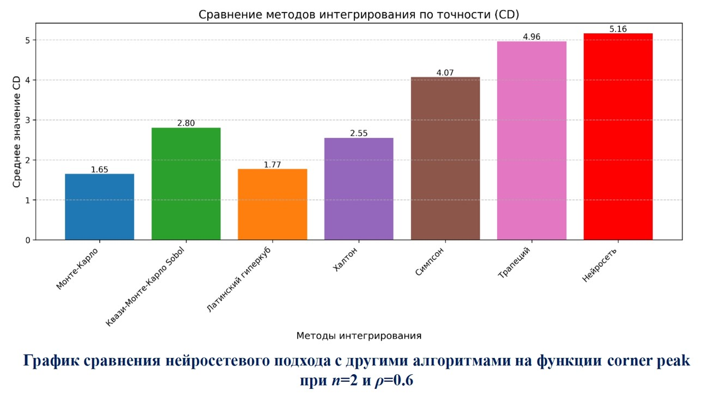
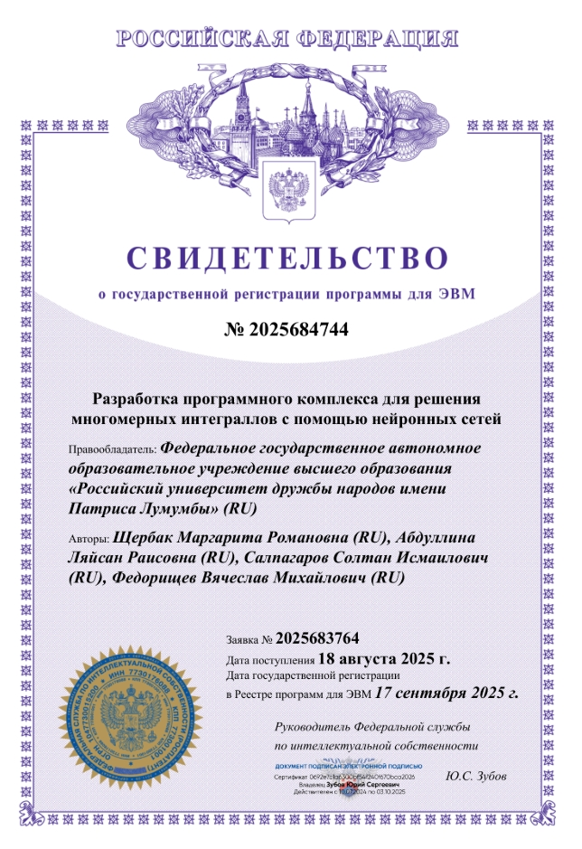

# Нейросетевое интегрирование как масштабируемое решение для многомерных задач

Данный репозиторий содержит программную реализацию нейросетевого метода для высокоточного вычисления многомерных интегралов. 

## Суть проекта
Классические методы (Монте-Карло, Симпсона и др.) сталкиваются с «проклятием размерности»: при росте числа переменных интегрируемой функции точность вычислений падает, а вычислительные затраты растут экспоненциально.

**Решение:** однослойная полносвязная нейронная сеть, которая обучается один раз на специально сформированной выборке. Ключевая особенность — **параметр ρ (ро)**, который балансирует равномерное распределение точек и распределение Метрополиса-Гастингса. 

**Ключевое преимущество:** обучение происходит один раз на большой области, после чего интеграл вычисляется аналитически через веса сети. Это позволяет мгновенно считать интегралы в любых вложенных подобластях без переобучения (*Train once, integrate anywhere*).

## Результаты
Программа ускоряет расчёты в 5-10 раз по сравнению с классическими методами. Метод протестирован на функциях от 2D до 6D (Параболоид, Гаусс, Corner Peak, Синус суммы квадратов).



### Проект выполнен при поддержке ОИЯИ (г. Дубна) и научного сообщества РУДН.

> **Свидетельство о государственной регистрации программы для ЭВМ:** № 2025684744 от 17.09.2025 (Роспатент).




## Как запустить

Вы можете запустить код прямо в браузере (не скачивая файлы) или развернуть его локально.

### 🌐 Запустить онлайн (Google Colab)
Нажмите на кнопку ниже, чтобы открыть блокнот в облачной среде:
[](https://colab.research.google.com/github/MargaritaShcherbak/Neural-Network-Integration/blob/main/Neural_Integration_Method.ipynb)

### 💻 Запустить локально
1. Установите необходимые библиотеки:
   ```bash
   pip install tensorflow numpy matplotlib scikit-learn scipy mpmath
